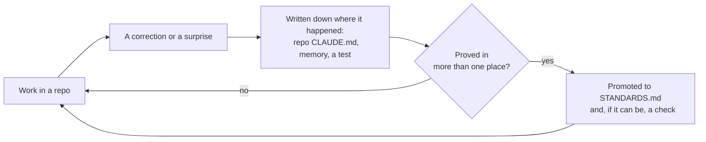

# 1. Principles

## In short

- Work as a surgical team: a person holds the design and the decisions; agents fill every
  supporting role.
- Keep the Skunk Works spirit: small, trusted, quick, with a simple release system and quality
  built into the work rather than inspected in afterwards.
- Put knowledge in the world: in files the next reader will open, at the point of the decision.
- Write once for both readers. Guidance that helps an agent helps a person, and the reverse.
- Prefer a check that runs to a rule that is remembered.
- Ratchet: existing debt may shrink, never grow, and new work starts clean.
- Rules come from practice, with the evidence named.
- The agent is held to the same bar as a person, and so is its output.
- Small, reversible steps; irreversible ones are confirmed by a human.

## A surgical team, with agents in every other chair

In *The Mythical Man-Month* (1975), Fred Brooks put forward Harlan Mills's idea of organising a
software team like a surgical team. One surgeon does the critical design and code. Everyone else
exists to make that one person effective. Brooks's reason was **conceptual integrity**, which he
called the most important consideration in system design: a system that reflects one coherent set
of ideas is better than one that reflects many good but uncoordinated ones. The catch was cost:
around ten people supporting one.

Agents change the economics. The supporting roles map almost one for one:

| Brooks's role | What it did | In an AI-native team |
|---|---|---|
| **Surgeon** | Designs, writes the critical parts, owns the result | The person: holds the design, decides direction, reviews, owns every irreversible step |
| **Copilot** | Alter ego who can do any part, thinks alongside | An agent pairing on the work: proposes, challenges, implements under review |
| **Toolsmith** | Builds the special tools the surgeon needs | Agents writing custom checks, scripts, test hooks, diagnostics |
| **Tester** | Devises tests, from the specification | Agents writing behavioural tests, soak runs, fault injection; CI running them on every change |
| **Language lawyer** | Knows the language and its corners deeply | Agents reading specs, upstream source and decompiled binaries |
| **Editor** | Turns the surgeon's notes into documentation | Agents drafting docs, PR bodies and release notes in the house style |
| **Program clerk** | Keeps the records of the work | Git, CI and the changelog: the record keeps itself |
| **Administrator** | Handles the logistics | Agents handling dependency PRs, CI waits, release chains and status |

Two things follow. First, conceptual integrity stays with the person: agents are fast enough to
produce a lot of plausible, inconsistent code, so the design has to be held somewhere, and written
down so every agent can read it. Second, the supporting roles need a system to work in: shared
knowledge (the [harness](04-the-harness.md)), shared standards, and [guardrails](05-guardrails.md)
that check every pair of hands the same way. A surgeon with ten fast assistants and no shared
system gets ten different operations.

Brooks's later essay *No Silver Bullet* separated **essential** complexity (the hard problem itself:
what to build, how the parts fit) from **accidental** complexity (the effort of expressing it).
Agents strip away a great deal of the accidental. The essential remains, and it is exactly the
surgeon's work: the design, the product judgement, the decisions that can't be undone.

## The Skunk Works spirit

Lockheed's Skunk Works, under Kelly Johnson, built aircraft in a fraction of the usual time with a
fraction of the usual people, working by a short list of rules. Several read as if written for a
team of people and agents:

- **Small, good, and trusted.** The project leader has near-complete authority, and the number of
  people involved is restricted "in an almost vicious manner". In an AI-native team the person
  count is tiny by design; agents carry the volume.
- **A very simple release system, flexible for making changes.** Here: a PR, a set of automated
  gates, a release PR and a tag. No change board, no ceremony, and every step reversible except the
  tag.
- **A minimum of reports, but important work recorded thoroughly.** No status theatre. The record
  is the commits, the PRs, the tests and docs that describe what is true now.
- **Push inspection back to the people doing the work, and don't duplicate it.** This is Deming's
  "build quality in" in engineering language (see [Quality](02-quality.md)): the checks run where
  the work happens, not in a separate gate at the end.
- **The builders test the product themselves.** The team owns its work end to end, all the way to
  whether it helps the user (see [Product](03-product.md)).
- **Close, daily trust with the customer.** Short loops from need to release to feedback.

The motto was "be quick, be quiet, be on time". Speed in this sense never comes from skipping
quality. It comes from small, reversible steps, trust that rests on guardrails rather than on
inspection by committee, and very few hand-offs.

## Knowledge in the world

Don Norman's distinction in *The Design of Everyday Things* is between knowledge in the head (what
a person has to remember) and knowledge in the world (what the environment tells them: a label, a
shape, a constraint). Good design moves knowledge into the world, so that people succeed without
having to remember.

An AI agent is the extreme case. It arrives with general skill and no memory of your repo. Every
session is its first day. Whatever it needs to do the right thing has to be somewhere it will read,
or be enforced by something it can't skip. A repo that depends on "everyone knows we don't do
that" fails an agent on the first change.

The useful discovery is that the same is true, less sharply, of people: the new starter, the
reviewer from another team, the maintainer two years from now, yourself after a holiday. Moving
knowledge into the world for the agent's sake improves things for all of them.

Knowledge lives in the world at four levels, from weakest to strongest:

| Level | Example | Holds when |
|---|---|---|
| Said once | "Remember to update the README table" in a chat | Someone remembers |
| Written down | A line in `CLAUDE.md` or a release checklist | Someone reads it at the right time |
| Checked | A CI step that fails when the README table is stale | Always, for everyone, without anyone remembering |
| Impossible to get wrong | Generated from the source, so there is nothing to keep in step | Always, with nothing to check |

Push each rule as far down that table as it will go. A rule that is only written down is a
candidate for a check; a check that compares two copies is a candidate for generating one from the
other.

## One body of content, two readers

It is tempting to write separate material for agents: terse prompt fragments, special syntax,
instructions in capitals. Resist it. The qualities that make guidance work for an agent are the
qualities that make it work for a person:

- **Current.** It says what is true now. History belongs in commits and PRs (see
  [STANDARDS.md](../STANDARDS.md#5-documentation)).
- **Located.** It is in the file the reader opens for the task: the repo's `CLAUDE.md`, the
  package README, the error message, the comment above the surprising line.
- **Specific.** A command that runs, a path that exists, a number with a unit. "Keep files small"
  is advice; "C# files 400 lines, enforced by `scripts/check-policies.mjs`" is a rule.
- **Reasoned.** It says why. A reader who knows why can handle the case the rule didn't foresee;
  one who only knows the rule will apply it where it doesn't fit.
- **Plain.** Short sentences, active voice, no jargon that needs a glossary.

When the agent misreads guidance, the fix is almost never "add a stronger instruction for the
agent". It is to make the guidance clearer for everyone, or to turn it into a check.

## Checks over memory

A rule enforced by CI holds on a tired Friday, for a new contributor, and for an agent that never
read the handbook. So the estate leans on automated gates (see [Guardrails](05-guardrails.md)):
warnings as errors, size and complexity budgets, security scanners, doc link checks, behavioural
tests. The handbook then only has to explain them.

Two properties make a check trustworthy:

1. **It fails on the thing you care about,** and you have seen it fail. A check that has never gone
   red might not be checking anything (see [Testing](06-testing.md#a-test-that-cannot-fail-proves-nothing)).
2. **It says how to fix what it found.** The size script names the file, its size and the budget;
   the release workflow says which version file disagrees with the tag. The message is the
   documentation at the moment it is needed.

## Ratchet, not amnesty

Adopting a strict rule in an existing codebase surfaces old violations. Fixing all of them first
stalls everything; ignoring them makes the rule meaningless. The ratchet is the middle path:

- Record existing violations in a baseline, at their current size.
- New code meets the rule from day one.
- A baselined item may shrink, never grow, and leaves the baseline when it is fixed.
- The baseline is stale if something shrank and the baseline wasn't lowered, which is also a
  failure, so it can't quietly go out of date.

The estate uses this for file and method sizes (`.policy/size-baseline.json`), analyzer findings
(`.editorconfig` baseline blocks) and logging style. Quality then only moves one way, and nobody
needs a "cleanup sprint".

## Rules come from practice

Every rule in [STANDARDS.md](../STANDARDS.md) started as something that went wrong, or something
that worked, in a real repo. The standards repo's own [`CLAUDE.md`](../CLAUDE.md) requires a new
rule to name the repo it came from. That keeps the handbook honest: no rule exists because it
sounded sensible, and every rule can be traced to the problem it solves.

The loop looks like this:

## Same bar for agent and human

An agent's change goes through the same PR, the same gates and the same review as anyone's. The
agent doesn't get looser rules because it is fast, or stricter ones because it is new. What
changes is where judgement sits: the agent does the work and reports faithfully; a person decides
the things that can't be undone (see [Working with agents](09-working-with-agents.md)).

## Small and reversible

Most mistakes are cheap if the step was small and can be undone: a PR can be reverted, a branch
deleted, a baseline lowered. A few can't: a package version published to a registry, a tag moved
on a public repo, a production deploy, a public issue on someone else's tracker. Design the flow
so the reversible steps are fast and automatic and the irreversible ones are few, explicit and
confirmed.
