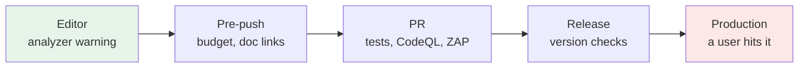

# 2. Quality: a system with nothing in the way

## In short

- Quality is the absence of breakdown, anywhere in the product, the process or the experience.
- Hunt non-quality. Anyone, person or agent, can point at friction, failure or waste and fix it.
- Most defects belong to the system, not the person. Fix the system: a check, a test, a clearer
  doc, a smaller step.
- Build quality in rather than inspecting it in at the end.
- Don't tamper. Reacting to every random failure (a re-run, a retry, a sleep) makes things worse.
  Find the cause, measure the rate, then change the system.
- Replace exhortations with mechanisms. "Be careful with X" is not guidance; a check is.
- Plan, do, study, act: every change is an experiment, and the rules here are its results.
- Drive out fear: report what broke plainly, including your own mistakes.

## Defining quality by its absence

"Excellence" is hard to define and harder to measure. Its absence is easy to see: the request that
hangs, the test that fails one run in twenty, the doc that sends a reader the wrong way, the review
that has to ask the same question again, the release step everyone forgets. Many of the people who
shaped how we think about quality found it more useful to hunt down non-quality than to describe
perfection:

- **Genichi Taguchi** defined quality as the loss a product imparts to society after it ships.
  Every breakdown, delay, frustration and maintenance hour downstream is a loss; quality is the
  absence of those losses.
- **Taiichi Ohno**, in the Toyota Production System, worked by removing *muda*, waste: anything
  that doesn't add value or interrupts flow. Waiting, defects, rework, overprocessing,
  unnecessary motion. Quality emerges when the obstacles to flow are gone.
- **Noriaki Kano** called the baseline layer of quality *must-be*: things nobody praises when they
  work and everybody notices when they don't. Brakes, not cup holders.
- **Dieter Rams** asked that good design be unobtrusive. You only notice the plumbing when it
  leaks.

Put together, they give a definition that is sharp enough to act on:

> **Quality is the absence of breakdown, anywhere in the product, the process or the experience.**
> Or more simply: **a system with nothing in the way.**

The advantage of a negative definition is that it is actionable. You can't tell a team, or an
agent, how to "create excellence". Anyone on the ground can point to where the system is broken,
clunky or failing, and fix that.

## Where non-quality hides

The definition says *anywhere*, and that matters, because the breakdowns a user feels are often
caused by breakdowns nobody sees.

| Where | What non-quality looks like | What hunts it in this estate |
|---|---|---|
| **The product** | A request hangs for ten minutes; a page leaks another tenant's data; a security header is missing; a page is slow | Behavioural tests, CodeQL, [ZAP](../docs/tools/zap.md), [k6](../docs/tools/k6.md), boundary regression tests |
| **The experience** | Wording that misleads ("taking longer than usual" on a wait that takes days); an inaccessible control; an error that doesn't say what to do | Plain-language rules, Playwright with semantic selectors, axe on every story, error states asserted twice |
| **The code** | A method nobody can follow, a file that only grows, duplication that drifts | [Code budgets](../docs/tools/code-budgets.md), [CodeScene](../docs/tools/codescene.md) delta, warnings as errors |
| **The process** | A flaky test that teaches everyone to re-run; a release step that lives in someone's head; a stacked PR closed by accident | Soak runs and root causes, release PRs and checks, written change flow |
| **The knowledge** | A doc that describes last year's design; guidance an agent can't find; a rule with no reason | Doc link checks, current-state docs, the [harness](04-the-harness.md) rules, guidance evals |
| **The supply chain** | A compromised package, a leaked key, an unpinned action | Vulnerability gate, secret scan, Zizmor, Dependabot cooldown, Trusted Publishing |

Each row is a kind of loss in Taguchi's sense, and each tool is a way of seeing it early, where it
is cheap.

## Deming: the system is the problem

W. Edwards Deming taught that most problems, he estimated well over ninety per cent, belong to the
system people work in, not to the people. A good worker in a bad system will lose every time. For a
repo built with agents this is liberating: when an agent (or a person) makes a mistake, the useful
question is never "how do we make them try harder?" but "what in the system let that through, and
what would have caught it?".

Several of Deming's fourteen points translate directly.

### Cease dependence on inspection

Quality can't be inspected into a product at the end; it has to be built into the process that
makes it. A final review that catches problems is better than nothing, but it finds them late, at
the most expensive point, and only the ones the reviewer happens to look for.

So the estate moves checks to where the work happens: the analyzer fails the build in the editor,
the size script fails before push, the security scanners run on every PR, the behavioural tests
state what must stay true. Review then has a better job: judgement about design and intent, not
hunting for missing headers.

### Eliminate slogans and exhortations

Deming warned against slogans that ask for better results without changing the means: "zero
defects", "do it right first time". Their equivalent in a repo is the instruction that asks for
care without providing a mechanism:

- "Be careful with security" changes nothing. "Every endpoint carries an explicit
  `RequireAuthorization` policy, and a test proves an anonymous request is refused" does.
- "Keep files small" is a slogan. "C# files 400 lines, enforced by `scripts/check-policies.mjs`,
  existing files baselined" is a mechanism.
- "Don't break the CSV format" is a hope. Tests that pin the exact bytes of the output, written
  before the dependency changed, are a guarantee.

Agents make this sharper. An agent will dutifully read "be careful" and has no way to act on it.
Give it a check and it will meet the check every time.

### Understand variation: don't tamper

Every process varies. Deming distinguished **common-cause** variation (the normal noise of the
system as it is) from **special-cause** variation (something specific happened). Treating one as
the other makes things worse. His funnel experiment shows it: adjusting the aim after every drop
of a marble, in response to noise, spreads the results wider than leaving it alone.

In software, tampering looks like:

- re-running a failed build until it goes green, and calling that fixed;
- adding a retry, a longer timeout or a `sleep` because a test failed once;
- "fixing" a flaky test by deleting the assertion that failed.

None of these change the system that produced the failure, so the failure rate is unchanged and
now hidden. The method instead (see [Diagnosing the hard ones](07-diagnosis.md)):

1. **Measure the rate.** Run it enough times to know whether it fails one in three or one in
   forty. A rate is a property of the system; a single failure is an anecdote.
2. **Find the cause** with evidence: stack dumps, traces, a reproduction outside the framework.
3. **Change the system** so that cause can't happen, and make the failure deterministic in a test
   so it can never come back silently.
4. **Measure again.** The new rate is the result.

A green re-run is not a fix. It is a sample.

### Plan, do, study, act

Deming's cycle (from Walter Shewhart) treats every change as an experiment: plan what you expect,
do it small, study what actually happened, act on what you learned. The estate runs it at every
scale:

- **A change:** write the test that states the behaviour, make it pass, read what CI and
  CodeScene say, adjust.
- **A fix:** reproduce, change, soak, compare the rates.
- **The standards:** a practice is tried in one repo, studied, and only then promoted into
  [`STANDARDS.md`](../STANDARDS.md), with the evidence named.

### Drive out fear

People hide problems they fear being blamed for, and hidden problems can't be fixed. The estate's
rule is to report findings plainly: name the defect and its impact, no "just a small edge case".
That applies to agents reporting their own work too: say a step was skipped, say a test is still
failing, say "my mistake" when a command went wrong and what was done about it. A report that
sounds better than the truth is itself a breakdown in the system.

### Break down barriers

Deming asked that departments work as one system. The software version is end-to-end ownership:
the people (and agents) building a feature care about its security, its operation, its docs and
whether it helps the user, not only whether it compiles. That is the subject of the next chapter,
[Product: from need to outcome](03-product.md).

## Quality is cheap when it is early

The cost of a breakdown grows with the distance it travels before someone sees it:

Every guardrail in [chapter 5](05-guardrails.md) exists to move a class of breakdown one box to the
left. When something does reach a user, the fix is two changes: the defect, and the missing
guardrail that would have caught it earlier.
