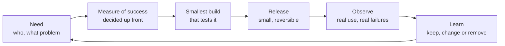

# 3. Product: from need to outcome

## In short

- Own the whole loop: the user's need, the change, its release, and whether it actually helped.
- Write down who it is for, what problem it solves and how you will know it worked, before
  building.
- Outcome over output. A merged PR is output; a user who can now do the thing is the outcome.
- Must-be qualities (security, reliability, accessibility, plain wording) are not features to
  trade. Delighters are optional and opt-in.
- Ship the smallest thing that tests the idea, then measure real use.
- When agents make code cheap, deciding what to build, and what not to, becomes the scarce skill.
- Check whether a constraint is real product intent or just where the code happens to be.

## Why engineers own product now

The classic split had product managers deciding what to build and engineers deciding how. AI
agents compress the "how": a feature that took a week of typing can take an afternoon of
directing and reviewing. What doesn't compress is knowing whether it was worth building, whether
it solved the problem, and what it broke for whom.

[SE Radio episode 746](https://se-radio.net/2026/11/se-radio-746-marian-kamenistak-on-product-management-for-software-engineers/),
with Marian Kamenistak, frames the response as a Product Builder: an engineer who combines
technical skill with product thinking and market awareness, and owns the whole lifecycle from
understanding the customer's need to measuring how the product is actually used, with success
measures defined up front. That is the posture this playbook asks of everyone working in a repo,
person or agent.

In a surgical team the Product Builder is the surgeon. Brooks's *No Silver Bullet* predicted the
shift: once the accidental work of expressing software gets cheap, what remains is the essential
work of deciding what it should be. The Skunk Works rule that the builders test their own product
is the same idea: the small team owns the whole loop, with no hand-off to someone else to find out
whether it worked.

It is also Deming's "break down barriers" applied to the work itself: when building, securing,
documenting, operating and measuring are one team's job, nothing falls between them.

## The loop

### 1. Start from the need

Before a line of code, write three sentences in the issue or PR:

- Who it is for (a citizen applying for a licence, a caseworker clearing a queue, a developer
  installing the package).
- What problem it solves for them, in their words, not the system's.
- How we will know it worked.

An agent asked to "add a dashboard" will build a dashboard. An agent told "caseworkers can't see
which applications have waited longest, so urgent ones are missed; done when the oldest waiting
item is visible without scrolling" will build the right thing, and can test it.

### 2. Decide the measure up front

A success measure chosen after the fact will always be met. Decide it first, and make it
observable:

- Behavioural: a test that states the user-visible outcome (see [Testing](06-testing.md)).
  This is the acceptance criterion in executable form.
- Quality: a performance threshold in k6, a ZAP finding that must stay closed, a page that
  must pass axe.
- Use: whether people actually do the thing. Count it in a way that respects them: aggregate
  counts, error rates, task completion in a usability session, support questions that stop
  arriving. One estate product stores no user data at all by design, so its measures are the
  ones that need none.
- Agent outcomes: for guidance aimed at agents, an evaluation that checks what the agent
  built, as in the [harness chapter](04-the-harness.md#testing-the-guidance).

### 3. Build the smallest thing that tests it

Small is a product decision as much as an engineering one. The smallest change that tests the
idea reaches a user sooner, is easier to review, is cheaper to reverse, and tells you sooner
whether the measure moves. A big batch hides which part helped and which part hurt.

### 4. Release, observe, learn

Ship behind the same gates as everything else, then watch what actually happens. The most
valuable product lessons in this estate came from real use, not from planning:

- A designer's agent built a site as hand-made CMS pages, ignoring the service design packages
  installed alongside it. The code was fine; the product had failed at the need, because nothing
  the agent read told it what the packages were for. The fix was product work: guides, MCP
  instructions and templates, then an evaluation to measure whether agents now build the right
  way.
- A first boot on SQLite stalled for minutes, intermittently. Nobody would have specified "first
  boot must not hang"; it is a must-be quality, invisible until it fails.

Then decide: keep it, change it, or remove it. Removing a feature that didn't earn its place is a
product success, not a failure.

## Must-be, performance and delight

Kano's model separates three kinds of quality, and they need different handling:

| Kind | Example | How to treat it |
|---|---|---|
| Must-be | Sign-in works and is secure; data doesn't leak between tenants; the page is accessible; wording doesn't mislead | Non-negotiable. Guarded by checks and tests. Never traded for a deadline |
| Performance | Pages load fast; a queue clears quickly; fewer steps to finish a task | Measured and improved deliberately, with thresholds that catch regressions |
| Delight | A themed waiting icon on a butterfly-sighting service | Optional, opt-in, off by default, and never at the expense of the first two |

Nobody thanks you for must-be qualities, and they are where most of the effort in this playbook
goes, because when one fails, quality drops to zero regardless of everything else. Public-service
work makes this especially clear: trust and plain language matter more than delight, so the
restrained version is the default and the decorative one is a deliberate author choice.

## Product judgement in everyday decisions

Most product decisions are small and made by whoever is building. A few habits keep them good:

- Ask whether a constraint is real intent or current scope. Planning an extraction, an agent
  proposed generalising a single-queue authoring screen so that one consumer could configure it
  back down. The single-queue limit turned out to be just how far the code had got, not a product
  decision, and the whole generalisation disappeared from the plan. When unsure, ask; don't build
  a compatibility layer around a guess.
- Prefer the simple version. "Why can't it be this simple?" is a product question. The
  simplest design that meets the need is easier to secure, test, explain and change.
- Keep examples generic. Demo and example content in a product repo should be broadly
  recognisable (a licence application, a callback request), not a niche domain only one customer
  understands.
- Recommend, then wait, on direction. For a non-trivial choice, an agent gives a
  recommendation and the key trade-off in a few sentences, and builds once the person agrees. On
  everything else it gets on with the work.
- Platform parity is part of the feature. If a product has an iOS and an Android app, a
  feature isn't done until both have it. "Android later" quietly becomes "Android never".

## What this asks of an agent

An agent working this way does more than complete the ticket:

- restates the need and the measure before building, and asks when either is missing;
- builds the smallest version that meets the measure, with the test that proves it;
- treats must-be qualities as part of every change, not a separate task;
- reports what it couldn't verify (a live end-to-end run it didn't do, a measure it can't see);
- notices friction it wasn't asked about, and says so plainly, because in a system with nothing in
  the way, everyone is responsible for what is in the way.
