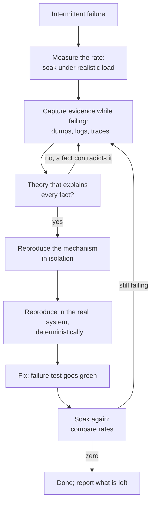

# 7. Diagnosing the hard ones

## In short

- Evidence before theory. Capture the system while it is failing: stack dumps, logs, traces.
- Write down the rate. "One run in fourteen" turns an anecdote into something you can test a fix
  against.
- Try to falsify your theory with a fact it can't explain. Keep looking until one theory explains
  every fact.
- Reproduce outside the framework, in the smallest program that shows the mechanism.
- Read the real source: upstream code, or the decompiled binary you actually run.
- Watch for the observer effect. Instrumentation that slows things down can hide a race.
- Check upstream before filing: the bug may already be reported, or fixed in a later version.
- A fix is done when the failure is deterministic in a test and the soak rate is zero.

## The shape of a hard bug

Easy bugs fail every time and point at their cause. Hard ones fail sometimes, somewhere else, and
the first three theories are wrong. The method below comes from one such case in this estate, an
integration suite that hung for about ten minutes roughly once in twenty runs, and it generalises.

## Capture while it fails

A failure you can't observe can't be diagnosed. Set up the capture before you try to reproduce:

- **A watchdog.** A loop that runs the suite and, when a run exceeds a time limit, takes several
  stack dumps a few seconds apart before killing it. (`dotnet-stack report -p <pid>` for .NET;
  every runtime has an equivalent.) Several dumps show what is stuck and what is moving.
- **Logs from the failing run,** uploaded by CI on failure, not only on success.
- **Target the right process.** A test runner and its host often share a command line; the first
  dumps here were of the runner, not the host. Check what you dumped.
- **Know the limits of a tool.** Synchronous stack dumps don't show async waits. When every thread
  looks idle, the stuck work is awaiting something; reach for a tracer or a heap dump instead.

## Falsify the theory

Each theory makes predictions. Look for the fact it can't explain:

- First theory: another connection holds the database write lock. But the logs showed other
  writers succeeding during the stall. A held lock would have blocked them too. Theory rejected.
- Second theory: a stale snapshot. In SQLite's write-ahead mode, a deferred transaction that reads,
  then sees another connection commit, can never upgrade to a writer; every retry fails with
  `SQLITE_BUSY_SNAPSHOT`, and the driver waits out its timeout on each one. That explained the
  successful writers, the timing (ten retries of thirty seconds, plus backoff) and the
  intermittency (it needs a commit in a tiny window).

The fact that kills a theory is worth more than the facts that support it.

## Reproduce the mechanism in isolation

Before touching the real system, prove the mechanism in the smallest program possible. Here, about
forty lines against the same driver version: open a deferred transaction, read, commit from a
second connection, write. Result: error 5, extended code 517, after exactly the command timeout,
on every attempt, while a third connection wrote freely. Taking a write lock first made the problem
disappear. The theory was now a fact.

## Reproduce in the real system, deterministically

Then force the same condition inside the real host, at the real point. A database command
interceptor in the test host committed from another connection just before the vulnerable
statement. Every boot then stalled without the fix and passed with it. See
[Testing](06-testing.md#making-rare-bugs-deterministic) for how to keep such a hook narrow and
honest.

## Read the real source

The cause was in the framework, not the application, so the next step was reading the framework:

- **Decompile what you run.** Decompiling the exact binary version in use (`ilspycmd` for .NET)
  answered questions the docs couldn't: the provider wraps connections to prefer deferred
  transactions; the template repository runs an uncached alias check before inserting; the
  document type save publishes its "saving" notification before taking its lock.
- **Then check the current upstream source** on each supported branch, because the version you
  run may not be the version being fixed.

## Trace when dumps aren't enough

The bug had more than one cause. After the first fix, a rarer stall remained, with no thread busy
in the database. A small tracer (a transaction interceptor logging each begin, first write and
commit, with the stack that began it, and reporting any transaction open more than a few seconds)
named the culprit directly: a framework notification handler reading every document type before
the save took its lock.

## The observer effect

The first version of the tracer formatted a full stack trace on every transaction. With it in
place, the stall stopped happening: 42 clean runs against about one stall in fifteen without it.
Instrumentation that slows each operation can close the very race you are hunting. The fix was to
capture cheaply (keep the raw stack object, format it only for the transaction that turns out to
matter), after which the stall reproduced on the second pass and the tracer caught it.

If a bug vanishes when you watch it, suspect the watching.

## Check upstream before filing

When the cause is in a dependency:

1. Search its tracker for the error, the mechanism and the code path.
2. Look for a fix on newer branches. Here the framework's maintainers had already fixed the
   relations part of the problem in their next major version, and made `SQLITE_BUSY_SNAPSHOT` fail
   at once instead of retrying for ten minutes. An open issue already asked for a backport.
3. Then decide what to contribute: evidence on an existing issue, a new issue for what isn't
   covered, or nothing if it is handled. See [Contributing upstream](10-contributing-upstream.md).

## Finish honestly

A diagnosis is finished when:

- the failure is deterministic in a test that goes red without the fix,
- a soak with the fix shows the rate has dropped to zero, or to a stated rate with a named cause,
- what remains is written down: in this case, a gap inside the framework that application code
  can't cover, the rate it was observed at, and where it is fixed upstream.

"It passed when I re-ran it" is not on that list.
