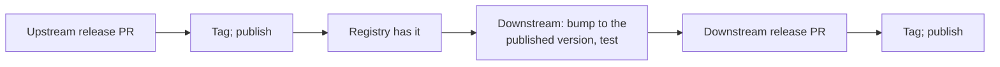

# 8. Change flow and releases

## In short

- Every change reaches `main` through a PR, gated by required checks, with the branch current.
- Conventional Commits, written for the person who will read the changelog.
- Small PRs. One concern each. A threat-surface change says so in the body.
- Stacked PRs: retarget the child to `main` before merging the parent with branch deletion.
- Update a branch by merging `main` into it, not by force-pushing.
- Before closing a Dependabot PR as superseded, check that `main` really has its versions.
- Releases: release PR (version and changelog), merge, then a tag publishes. A person confirms
  the tag.
- Downstream repos update in order, each against the published version, not a local build.
- Never commit generated runtime state; check `git status` after running anything.

Kelly Johnson asked for "a very simple drawing release system with great flexibility for making
changes". This chapter is that system for a small team of people and agents: a PR, automated gates,
a release PR, a tag. Nothing more is needed, and everything except the tag can be undone.

## Pull requests

`main` is protected by a ruleset: no deletion, no force push, PR required, required checks, branch
current before merge, no bypass (see [branch protection](../docs/tools/branch-protection.md)). That
holds for a one-line fix and for an agent's change alike.

A good PR body is written for a reviewer, and later a reader, with no context:

- **What and why**, in plain language.
- **What was checked**: the commands run and their results, including what was not verified (a
  live end-to-end run, a measure that can't be seen from CI).
- **What changes for users**, and for package consumers, how to upgrade.
- **Threat surface**: anything that moves it, named.

The narrative of how a fix was found belongs here and in the commit, never in the docs (see
[STANDARDS.md](../STANDARDS.md#5-documentation)).

## Commits

[Conventional Commits](https://www.conventionalcommits.org/): `feat:` is minor, `fix:` and the
other types are patch, `feat!:` or a `BREAKING CHANGE:` line is major and says how to upgrade.
The changelog is written from these at release time, so write the subject for a package user:
"bulk dataset upload and download read and write CSV exactly as before", not "bump CsvHelper".

Deciding breaking versus routine is a judgement about consumers. A dependency's new major version
that only affects consumers who also use that dependency directly can be routine, with a clear note
in the changelog; say which you chose and why in the PR.

## Stacked PRs

A stacked PR targets another PR's branch. Merge the parent with `--delete-branch` and GitHub
closes the child, because its base no longer exists. The child can't be reopened onto the deleted
base, so the work has to be recreated as a new PR.

- **Before merging the parent,** retarget the child to `main`:
  `gh pr edit <child> --base main`.
- **After the parent squash-merges,** the child still carries the parent's original commits. Merge
  `main` into the child (it resolves to `main` plus the child's own change) rather than rebasing
  and force-pushing.

## Keeping branches current

Branch protection requires a branch to be current before it merges, so after every merge to
`main`, other open PRs need updating. Prefer `gh pr update-branch <n>` or merging `main` into the
branch. Rebasing and force-pushing rewrites history others may have fetched, and an agent's
permission mode will normally refuse it. Merge commits on a feature branch cost nothing when the
PR is squash-merged.

When several PRs are green at once, merge one, update the next, wait for its checks, repeat. It is
slower than merging them all, and it is the only order in which every merge was tested against
the `main` it landed on.

## Dependency updates

Dependabot opens grouped PRs weekly, after a seven-day cooldown. A larger hand-made dependency PR
often supersedes several of them. Before closing one as superseded, compare its versions with
`main`: every package it bumps should be at that version or higher on `main`. Close with a comment
naming the PR that superseded it. A Dependabot PR that is genuinely new and green is merged like any
other.

When a dependency has a new major version, treat it as a behaviour change until proved otherwise:
pin today's behaviour in tests first (see [Testing](06-testing.md#pin-behaviour-before-you-change-it)).

## Releases

A release is the one routine step that can't be undone: a version published to a registry is
there for good. So it is split into a reviewable part and an irreversible part:

1. **Release PR** (the `/release` command in the [plugin](../plugin/)): infer the bump from the
   commits since the last tag, bump every version file, write the changelog entry, update any
   compatibility table in the README and regenerate derived docs, run the pre-release checks.
2. **Merge** it once green.
3. **Tag** the merge commit `v{version}`. The tag triggers the publish workflow, which checks every
   version file matches the tag, builds, tests, packs and publishes with Trusted Publishing.
   A person confirms this step.
4. **Wait for the registry** to index the new version before anything downstream depends on it.

### Releasing a chain

When packages depend on each other across repos, release in dependency order, each against the
**published** upstream version:

Testing downstream against a local build of upstream proves less: the published package is what
consumers get. For work before a release, restore from a local folder feed
(`-p:RestoreAdditionalProjectSources=<folder>`) rather than editing the committed NuGet config.

## Runtime state

Running an app writes files: databases, caches, generated keys, rewritten config. Before staging,
check `git status` and stage named files rather than everything. The secret scan catches generated
keys; it can't catch a rewritten setting that silently changes behaviour for everyone else.
